## Zweitstimmenanteile der Bundestagswahlen 2021 und 2025 {.custom-smaller}

<div style="position: relative; width: 110%; margin-top: -1.2em;">

```{r, echo=FALSE, out.width="100%"}
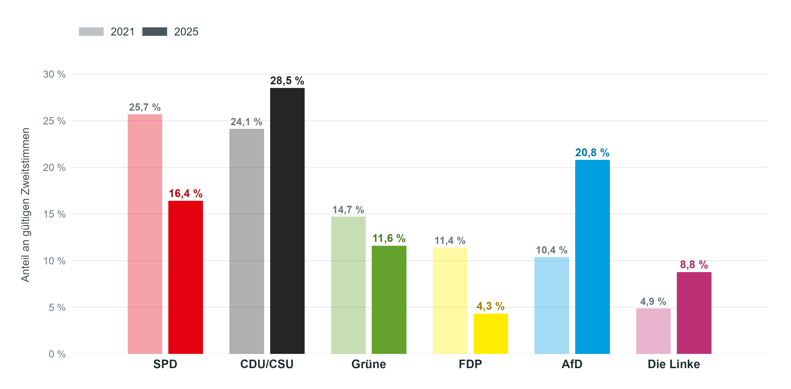
```

<div style="position: absolute; left: 0; right: 0; bottom: -0.8em; text-align: center; font-size: 0.53em; line-height: 1;">
Daten: Die Bundeswahlleiterin (2021, 2025)
</div>

</div>


## Zweitstimmenanteile der Bundestagswahlen 2021 und 2025 {.custom-smaller .research-slide visibility="uncounted"}

<div style="position: relative; width: 110%; margin-top: -1.2em;">

```{r, echo=FALSE, out.width="100%"}

```

<div style="position: absolute; left: 0; right: 0; bottom: -0.8em; text-align: center; font-size: 0.53em; line-height: 1;">
Daten: Die Bundeswahlleiterin (2021, 2025)
</div>

</div>

::: {.research-box}
**Schätzung struktureller Einflüsse auf die Wählerwanderung zwischen den Bundestagswahlen 2021 und 2025 mittels ökologischer Inferenz**
:::

::: {.research-details .fragment}
- Welche regionalen Strukturmerkmale stehen mit den Übergangsraten zur AfD in Zusammenhang?
- Unterscheiden sich die Zusammenhänge zwischen den Herkunftsgruppen?
- Welche Methodik ist zur Schätzung von Übergangsraten und strukturellen Einflüssen auf diese nötig?
:::

---

## Agenda {.custom-smaller .top-slide}

1.  Ökologische Inferenz und nslphom

2.  Datengrundlage und -aufbereitung

3.  Ost-Fokussierung und nslphom-Ergebnisse

4.  Regressionsmodell und Bootstrap

5.  Ergebnisse

6.  Diskussion

7.  Fazit

---

## Ökologische Inferenz: Das Grundproblem {.custom-smaller .top-slide}

::::: columns
::: {.column width="52%"}

Für jede räumliche Einheit $i$:

$$
\small
\begin{array}{c|ccc|c}
 & k=1 & \cdots & k=K & \text{2021} \\ \hline
j=1 & N_{i11} & \cdots & N_{i1K} & x_{i1} \\
\vdots & \vdots & & \vdots & \vdots \\
j=J & N_{iJ1} & \cdots & N_{iJK} & x_{iJ} \\ \hline
\text{2025} & y_{i1} & \cdots & y_{iK} & n_i
\end{array}
$$

:::

::: {.column width="48%"}

**Beobachtet**

- Wahlergebnisse 2021: $x_{ij}$
- Wahlergebnisse 2025: $y_{ik}$

**Unbekannt**

- Übergänge $N_{ijk}$ zwischen beiden Wahlen

$$
\sum_k N_{ijk}=x_{ij},
\qquad
\sum_j N_{ijk}=y_{ik}
$$

:::
:::::

::: {.fragment .ei-takeaway}
**Gleiche Randverteilungen können zu unterschiedlichen Übergangsmatrizen gehören.**
:::

## Woher kommt die Information? {.custom-smaller}

::::: columns
::: {.column width="47%"}

### Eine räumliche Einheit

Gesuchte Übergangsrate:

$$
p_{ijk} = \frac{N_{ijk}}{x_{ij}}
$$

Beobachteter Zielrand:

$$
y_{ik}
=
\sum_{j=1}^{J} x_{ij}p_{ijk}
$$

Gewichtete Summe mehrerer unbekannter Übergangsraten

**$\Rightarrow$ nicht eindeutig identifiziert**

:::

::: {.column width="6%"}
:::

::: {.column width="47%"}

### Viele räumliche Einheiten

$$
t_{ik}
=
\sum_{j=1}^{J}
s_{ij}\,p^G_{jk},
\qquad i=1,\ldots,I
$$

$\Rightarrow$ unterschiedliche Zusammensetzungen ($I$ Einheiten) liefern unterschiedliche Restriktionen auf dasselbe Übergangsmuster

**Annahme:** lokale Übergangsmuster variieren nicht beliebig zwischen den Einheiten $\Rightarrow$ **gemeinsame Variation liefert Information**

:::
:::::

## nslphom: Globale Referenz, lokale Übergänge {.custom-smaller}

::::: columns
::: {.column width="45%"}

**1. Globale Ausgangsschätzung**

$$
\hat P^G =
\left(\hat p^G_{jk}\right)
$$

Gemeinsames Übergangsmuster über alle räumlichen Einheiten

<br>

**2. Lokale Schätzung**

$$
\hat N_i
=
\arg\min_{N_i \in \mathcal F_i}
\sum_{j,k}
\left|
N_{ijk}-x_{ij}\hat p^G_{jk}
\right|
$$

mit exakt eingehaltenen lokalen Rändern.

:::

::: {.column width="55%"}

<div style="position: relative; width: 100%;">

```{r, echo=FALSE, out.width="100%"}
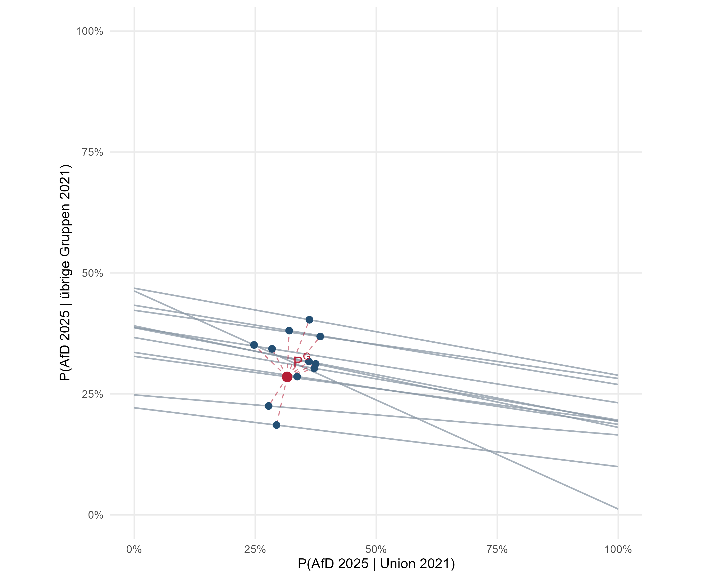
```

<div style="position: absolute; left: 0; right: 0; bottom: -0.9em; text-align: center; font-size: 0.53em; line-height: 1;">
Darstellung nach King (1997)
</div>

</div>

:::
:::::

## Duales nslphom {.custom-smaller}

nslphom in beide mathematischen Richtungen schätzen und kombinieren:

$$
2021 \longrightarrow 2025
\qquad \text{und} \qquad
2025 \longrightarrow 2021
$$

$$
\hat N_i^{(w)}
=
\frac{
H_{12}^{-1}\hat N_i^{(12)}
+
H_{21}^{-1}\hat N_i^{(21,T)}
}{
H_{12}^{-1}+H_{21}^{-1}
}
$$

::: {.fragment}

$$
\hat p_{ijk}^{(w)}
=
\frac{\hat N_{ijk}^{(w)}}{x_{ij}}
$$
$H_{12},H_{21}$: HETe-Werte der beiden Schätzrichtungen

Lokale Übergangsraten, z. B. Union $\rightarrow$ AfD, SPD $\rightarrow$ AfD, Nichtwählende $\rightarrow$ AfD
:::

## Datengrundlage & räumliche Harmonisierung {.custom-smaller .prep-uniform}

::: {.data-cards}

::: {.data-card}
**Bundestagswahlen 2021 & 2025**

Bundeswahlleiterin · Wahlbezirksebene

Amtliche Wahlbezirksergebnisse  
(Zweitstimmen)
:::

::: {.data-card}
**Regionale Strukturmerkmale**

INKAR · Berichtsjahr **2023**

10 Merkmale aus Demografie,  
Wirtschaft, Siedlungsstruktur,  
Mobilität und Grenzlage
:::

::: {.data-card-stack}

::: {.data-card .data-card-small}
**Geometrien**

BKG · Gebietsstand **01.01.2025**

kartografische Darstellung
:::

::: {.data-card .data-card-small}
**Gemeindegebietsänderungen**

Statistisches Bundesamt · <br>
**2021–2024**
:::

:::

:::


::: {.data-flow .fragment}

::: {.flow-box}
**Räumliche Harmonisierung**

- Briefwahlauszählungen  
- Gemeindegebietsänderungen  
- §68 BWO
:::

::: {.flow-arrow}
→
:::

::: {.flow-box}
<span class="data-number">5.965</span>

vergleichbare räumliche Einheiten  
in Deutschland
:::

::: {.flow-arrow}
→
:::

::: {.flow-box .flow-main}
<span class="data-number">1.078</span>

Aggregationseinheiten in  
Ostdeutschland ohne Berlin
:::

:::


## Vom Wahlergebnis zum Modellinput {.custom-smaller .prep-uniform}

**Wahloptionen in beiden Wahljahren**

<div class="category-grid">
  <div class="category-chip">AfD</div>
  <div class="category-chip">SPD</div>
  <div class="category-chip">Union</div>
  <div class="category-chip">Linke/Grüne</div>
  <div class="category-chip">Andere</div>
  <div class="category-chip">Nichtwählende</div>
</div>

::: {.prep-flow}

::: {.prep-box}
**Zusammenfassung**

CDU + CSU → **Union**

Linke + Grüne → **Linke/Grüne**

übrige Parteien (<12%) + ungültige Zweitstimmen → **Andere**

**Nichtwählende**
:::

::: {.prep-arrow}
→
:::

::: {.prep-box}
**Gleiche Gesamtmasse**

2025 wird innerhalb jeder Einheit auf die Gesamtmasse von 2021 skaliert
:::

::: {.prep-arrow}
→
:::

::: {.prep-box .prep-result}
**Input für nslphom**

2021: $1078 \times 6$

2025: $1078 \times 6$

gleiche Einheiten  
gleiche Kategorien  
gleiche Gesamtmassen
:::

:::

## Heterogenität der deutsch\-landweiten Schätzung {.custom-smaller .hete-map-slide}

::: {.hete-map-large}

```{r, echo=FALSE, out.width="100%"}
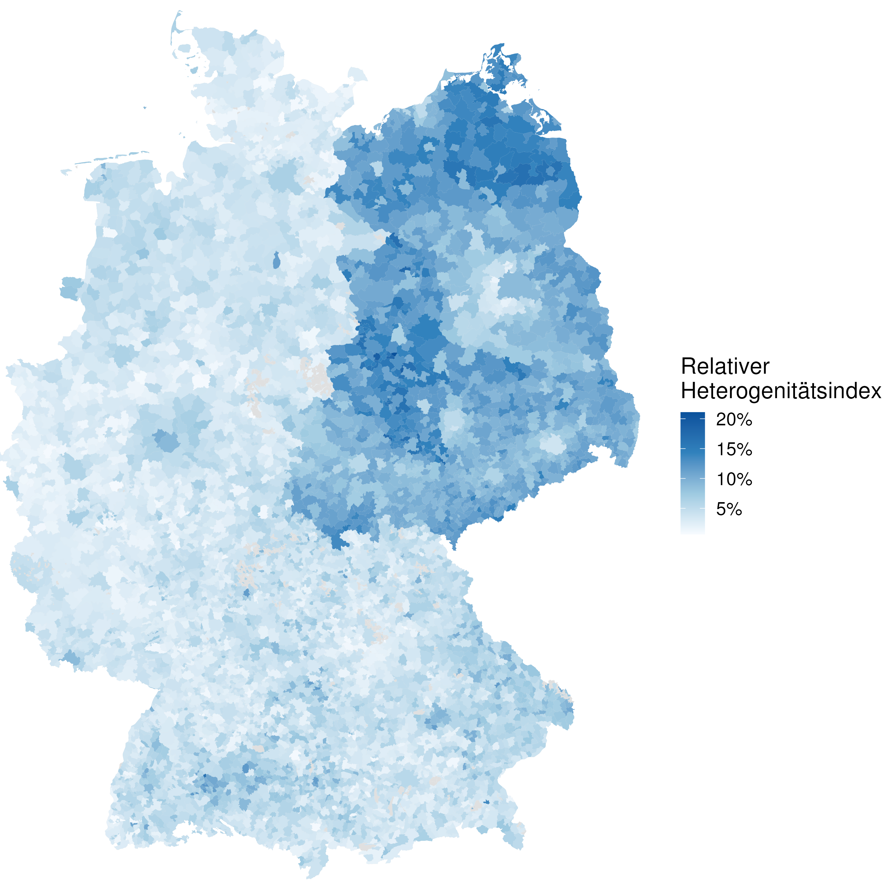
```

:::

::: {.research-details style="top: 57%; left: 78%; width: 40%; transform: translateX(-50%); font-size: 0.7em; line-height: 1.18; padding: 0.6em 0.8em;"}

$$
EHet_i^{rel}
=
100 \cdot
\frac{
\frac{1}{2}\sum_k \left|y_{ik}-\hat y_{ik}\right|
}{
\sum_k y_{ik}
}
$$

**Anteil der Zielmasse**, der umverteilt werden müsste, damit globale Erwartung und beobachteter Zielrand übereinstimmen.

:::

## nslphom-Ergebnisse für Ostdeutschland {.custom-smaller .top-slide}

<div style="text-align: center; margin-top: -0.4em;">

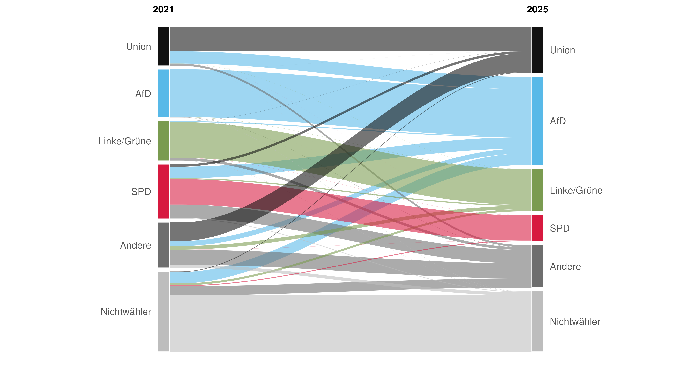

</div>

## Regionale Strukturmerkmale 2023 {.custom-smaller .top-slide}

::: {style="font-size: 0.8em; line-height: 1.08;"}

| Thema | Strukturmerkmal | Aufbereitung |
|---|---|---|
| Siedlungsstruktur | **Einwohnerdichte** | INKAR-Indikator |
| Peripherie / Nahversorgung | **Supermarktentfernung** | bevölkerungsgewichtet |
| Demografie | **Durchschnittsalter** | bevölkerungsgewichtet |
| Bevölkerungsdynamik | **Wanderungssaldo** | bevölkerungsgewichtet |
| Pendelmobilität | **Fernpendleranteil** | gewichtet nach Beschäftigten am Wohnort |
| Regionale Wirtschaftslage | **Kommunale Steuerkraft im Kreis** | Kreiswert; ggf. bevölkerungsgewichtet |
| Haushaltsstruktur | **Haushaltsgröße** | rekonstruiert / aggregiert |
| Materielle Lage | **Niedrige Haushaltseinkommen** | gewichtet nach geschätzter Haushaltszahl |
| Arbeitsmarkt | **Arbeitslosenanteil 15–64** | $\sum$ Arbeitslose / $\sum$ Bevölkerung 15–<65 |
| Grenzlage | **Entfernung zur Staatsgrenze** | Distanz ab bevölkerungsgewichtetem Mittelpunkt |

:::

## Zielgrößen: Übergangsraten zur AfD {.custom-smaller}

```{r, echo=FALSE, out.width="112%", fig.align="center"}
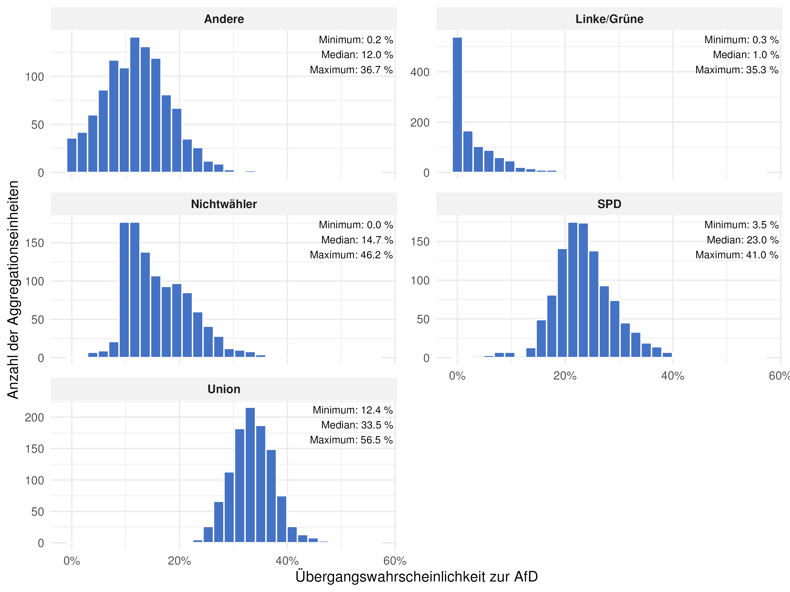
```

::: {.research-details .target-note-position .fragment}
Die Zielgrößen sind **mit nslphom geschätzte lokale Übergangsraten** und damit nicht direkt beobachtet.
:::


## Gewichtetes lineares Regressionsmodell {.custom-smaller}

Für jede Herkunftsgruppe $j$ wird ein eigenes Modell geschätzt:

$$
\hat p_{ij\rightarrow \mathrm{AfD}}
=
\alpha_j
+
\sum_{r=1}^{10}
\beta_{jr}z_{ir}
+
\varepsilon_{ij}
$$

<div style="font-size: 0.85em; margin-top: -0.35em; margin-bottom: -0.15em;">

$$
\hat{\boldsymbol\beta}_j
=
\arg\min_{\boldsymbol\beta_j}
\sum_{i=1}^{I}
x_{ij}
\left(
\hat p_{ij\rightarrow \mathrm{AfD}}
-
\alpha_j
-
\sum_{r=1}^{10}\beta_{jr}z_{ir}
\right)^2
$$

</div>

- $z_{ir}$: **z-standardisiertes Strukturmerkmal** $r$ in Aggregationseinheit $i$
- **Gewichtung:** mit $x_{ij}$ = Größe der Herkunftsgruppe $j$ in Einheit $i$ (2021)

::: {.fragment}
**Interpretation von $\beta_{jr}$:**  
Mittlere Änderung der geschätzten Übergangsrate bei einer Erhöhung des Strukturmerkmals um eine Standardabweichung, c. p.
:::


## Regressionsdiagnostik {.custom-smaller}

```{r, echo=FALSE, out.width="100%"}
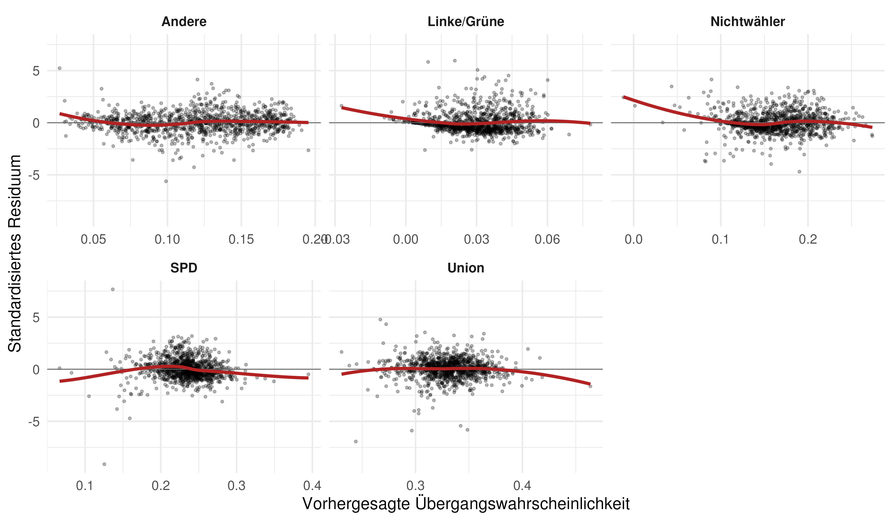
```


## Warum ein Bootstrap der vollständigen Schätzkette? {.custom-smaller .prep-uniform}

<p style="font-size: 1.65rem;">
Für jede Bootstrapwiederholung $b$ ($B=500$ erfolgreiche Wiederholungen):
</p>

$$
\large
I^{(b)}
=
\left(i_1^{(b)},\ldots,i_I^{(b)}\right),
\qquad
i_l^{(b)}
\overset{iid}{\sim}
\mathrm{Uniform}\{1,\ldots,1078\}
$$

::: {.prep-flow}

::: {.prep-box}
**1. Resampling**

1.078 räumliche Einheiten  
mit Zurücklegen ziehen

Wahlränder und Strukturmerkmale  
gemeinsam übernehmen
:::

::: {.prep-arrow}
→
:::

::: {.prep-box}
**2. Ökologische Inferenz**

nslphom-Input  
neu zusammensetzen

duale nslphom-Schätzung  
erneut durchführen
:::

::: {.prep-arrow}
→
:::

::: {.prep-box .prep-result}
**3. Regression**

fünf gewichtete  
Regressionsmodelle

Koeffizienten

$$
\hat\beta_{jr}^{(b)}
$$
:::

:::

$$
\large
CI_{0.95}(\beta_{jr})
=
\left[
Q_{0.025}\left(\hat\beta_{jr}^{(1)},\ldots,\hat\beta_{jr}^{(B)}\right),
\;
Q_{0.975}\left(\hat\beta_{jr}^{(1)},\ldots,\hat\beta_{jr}^{(B)}\right)
\right]
$$

## Räumliche Gegenüberstellung: Niedrige Haushaltseinkommen und Union $\rightarrow$ AfD {.custom-smaller .top-slide}

```{r, echo=FALSE, out.width="100%"}
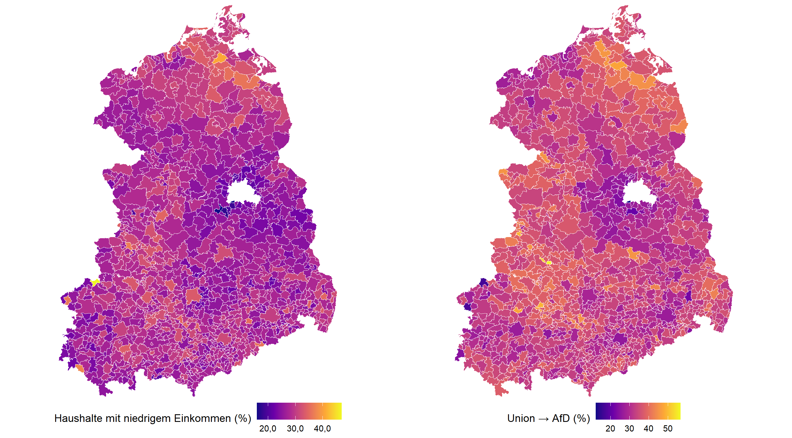
```

---

## Räumliche Gegenüberstellung: Arbeitslosenanteil und Nichtwählende $\rightarrow$ AfD {.custom-smaller .top-slide}

```{r, echo=FALSE, out.width="100%"}
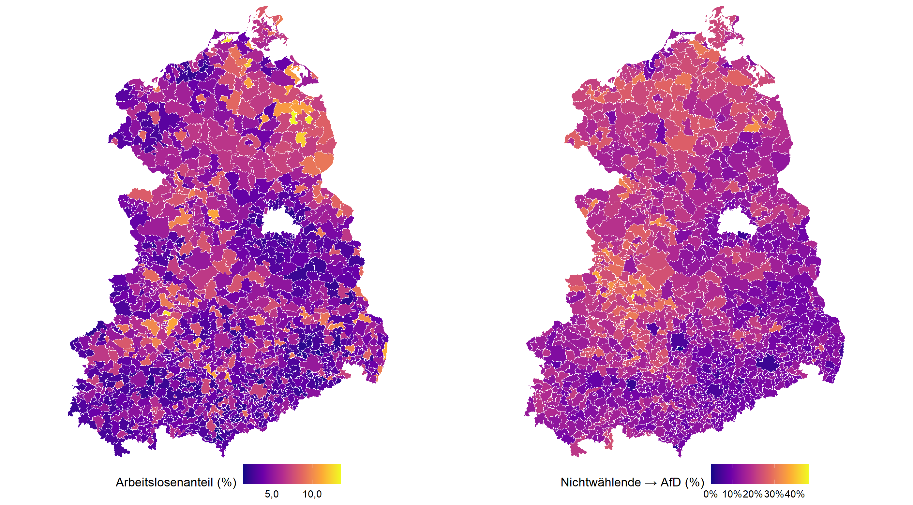
```

---

## Räumliche Gegenüberstellung: Grenzdistanz und Andere $\rightarrow$ AfD {.custom-smaller .top-slide}

```{r, echo=FALSE, out.width="100%"}
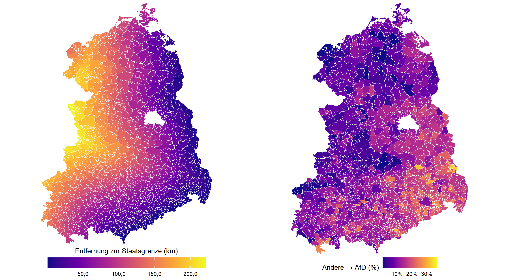
```

---

## Bootstrap-Stabilität der Regressionsbefunde {.custom-smaller .top-slide}

```{r, echo=FALSE, out.width="100%"}
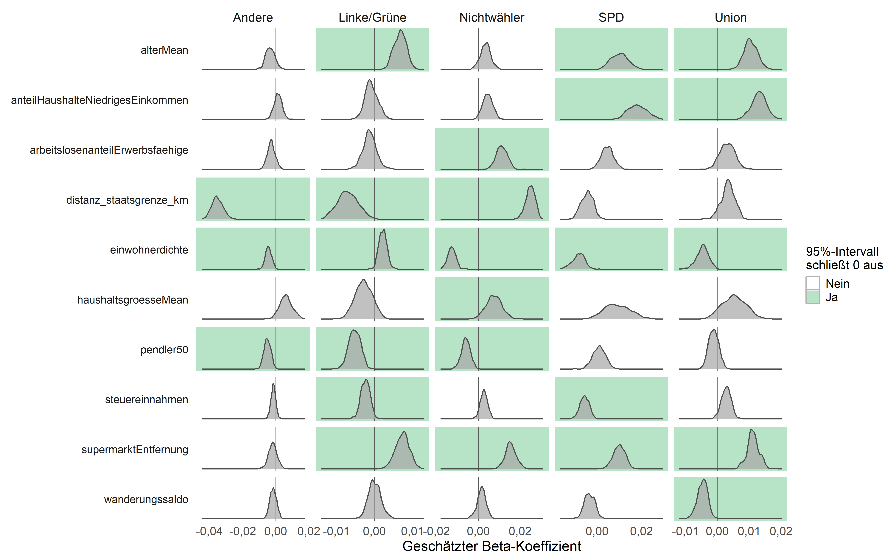
```

---

## Bootstrap-Stabilität der Regressionsbefunde {.full-image-slide visibility="uncounted" background-image="Charts/bootstrap/bootstrap_beta_verteilungen_ostdeutschland.png" background-size="contain" background-position="center" background-repeat="no-repeat"}


## Diskussion: Zentrale Einschränkungen {.custom-smaller .prep-uniform}

::: {.data-cards}

::: {.data-card style="text-align: left;"}
<div style="text-align: center;">
**Ökologische Inferenz**
</div>

exakte Reproduktion der Ränder validiert nicht die tatsächlichen individuellen Übergänge (Simulation)

zu anderen Verfahren relativ robuste nslphom Schätzungen
:::

::: {.data-card style="text-align: left;"}
<div style="text-align: center;">
**Zweistufige Analyse**
</div>

geschätzte Übergangsraten als Zielgröße der Regression

Bootstrap entfernt keinen systematischen ökologischen Bias
:::

::: {.data-card style="text-align: left;"}
<div style="text-align: center;">
**Daten & Modell**
</div>

Sammelkategorien  
**Andere** und **Linke/Grüne**

Skalierung auf gleiche Gesamtmasse

Strukturmerkmale nur für 2023

lineares Modell trotz Zielgröße in $[0,1]$

Einschränkung auf Ostdeutschland
:::

:::

::: {.fragment}
**vorsichtige Interpretation:** Linke/Grüne wegen der starken Häufung sehr kleiner geschätzter Übergangsraten.  

<br>  

Keine Individual- oder Kausalaussagen möglich.
:::


## Diskussion: Robustheit und weiterer Forschungsbedarf {.custom-smaller .prep-uniform}

::: {.data-cards}

::: {.data-card style="text-align: left;"}
<div style="text-align: center;">
**Robustheit prüfen**
</div>

alternative Parteigruppierungen

andere räumliche Zuschnitte

andere EI-Spezifikationen

systematischere Variablenauswahl
:::

::: {.data-card style="text-align: left;"}
<div style="text-align: center;">
**Regression erweitern**
</div>

Fractional-Response-Modelle

nichtlineare Zusammenhänge

multinomiale Modelle
:::

::: {.data-card style="text-align: left;"}
<div style="text-align: center;">
**Ökologische Inferenz verbessern**
</div>

Kontextvariablen bereits in der ersten Stufe berücksichtigen

Sensitivität gegenüber verbleibendem Confounding prüfen
:::

:::

::: {.research-details .fragment style="top: 64%;"}
**Unterschiedliche Validierungsbausteine:**  
Simulationen (Recovery-Tests, Methodenvergleiche), Heterogenitätsmaße, Bootstrap.
:::

## Fazit {.custom-smaller .top-slide}

- **Lokale Übergangsraten zur AfD sind aus Aggregatdaten schätzbar**, bleiben aber modellbasiert und nicht direkt beobachtet.

- Die Zusammenhänge mit regionalen Strukturmerkmalen **unterscheiden sich nach Herkunftsgruppe**.

- Mehrere bedingte Zusammenhänge zeigen sich im **Bootstrap richtungsstabil**.

- Die Ergebnisse sind **regional und nicht kausal** zu interpretieren.

- Methodisch entscheidend sind **räumliche Harmonisierung, Heterogenitätsdiagnose und Unsicherheitsquantifizierung der Schätzkette**.


## Datenquellen {.custom-smaller .top-slide}

::: {style="font-size: 0.62em; line-height: 1.28;"}

**Die Bundeswahlleiterin (2021).**  
*Bundestagswahl 2021: Wahlbezirksergebnisse, Datensatzbeschreibung und endgültiges Ergebnis Deutschland.*  
Datensatz „Ergebnisse nach Wahlbezirken“; Abruf am 21.09.2026.

**Die Bundeswahlleiterin (2025).**  
*Bundestagswahl 2025: Wahlbezirksergebnisse, Datensatzbeschreibung und endgültiges Ergebnis Deutschland.*  
Datensatz „Ergebnisse nach Wahlbezirken“; Abruf am 21.09.2026.

**Statistisches Bundesamt (2021–2024).**  
*Namens- und Gebietsänderungen der Gemeinden, Jahresdateien 2021 bis 2024.*  
Gebietsänderungen im Zeitraum 01.01.2021 bis 31.12.2024; Abruf am 14.09.2026.

**Bundesinstitut für Bau-, Stadt- und Raumforschung (BBSR) (2025).**  
*Laufende Raumbeobachtung des BBSR – INKAR, Ausgabe 07/2025.*  
Berichtsjahr der verwendeten Strukturindikatoren: 2023; Abruf am 15.07.2026.

**Bundesamt für Kartographie und Geodäsie (BKG) (2025).**  
*Verwaltungsgebiete 1:250 000 (VG250), Stand 01.01.2025.*  
Abruf am 14.09.2026.

:::

## Quellen und Literatur – Auswahl {.custom-smaller .top-slide}

::::: columns
::: {.column width="50%"}

::: {style="font-size: 0.58em; line-height: 1.18;"}

**Ökologische Inferenz und nslphom**

**Pavía, J. M. & Romero, R. (2024a).**  
Improving Estimates Accuracy of Voter Transitions: Two New Algorithms for Ecological Inference Based on Linear Programming.  
*Sociological Methods & Research, 53*(3), 1491–1533.

**Pavía, J. M. & Romero, R. (2023).**  
Data Wrangling, Computational Burden, Automation, Robustness and Accuracy in Ecological Inference Forecasting of R×C Tables.  
*SORT, 47*(1), 151–186.

**Pavía, J. M. & Romero, R. (2024b).**  
Symmetry Estimating R×C Vote Transfer Matrices from Aggregate Data.  
*JRSS Series A, 187*(4), 919–943.

**Gschwend, T. (2006).**  
Ökologische Inferenz.  
In: *Methoden der Politikwissenschaft*, 227–237.

**Forcina, A. & Pellegrino, D. (2019).**  
Estimation of Voter Transitions and the Ecological Fallacy.  
*Quality & Quantity, 53*, 1859–1874.

:::
:::

::: {.column width="50%"}

::: {style="font-size: 0.58em; line-height: 1.18;"}

**Unsicherheit, Identifikation und Anwendung**

**Bracalente, B., Forcina, A. & Falocci, N. (2026).**  
Determinants of Vote Transitions by Ecological Inference within Small Areas.  
*Spatial Statistics, 71*, 100950.

**Herron, M. C. & Shotts, K. W. (2003).**  
Using Ecological Inference Point Estimates as Dependent Variables in Second-Stage Linear Regressions.  
*Political Analysis, 11*(1), 44–64.

**Kuriwaki, S. & McCartan, C. (2026).**  
The Role of Confounders and Linearity in Ecological Inference: A Reassessment.  
*arXiv:2601.07668*.

**Klima, A. et al. (2016).**  
Estimation of Voter Transitions Based on Ecological Inference: An Empirical Assessment of Different Approaches.  
*AStA Advances in Statistical Analysis, 100*(2), 133–159.


**Cho, W. K. T. & Gaines, B. J. (2004).**  
The Limits of Ecological Inference: The Case of Split-Ticket Voting.  
*American Journal of Political Science, 48*(1), 152–171.

:::
:::
:::::


## Anhang: Wahl von iter_max {.custom-smaller}

```{r, echo=FALSE, out.width="100%"}
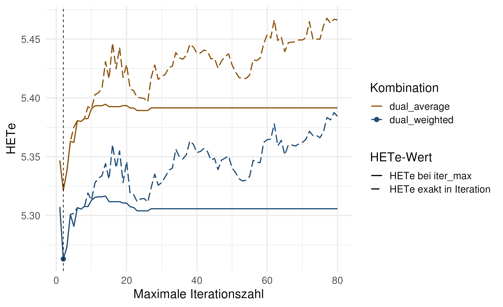
```

## Anhang: HETe und relativer EHet {.custom-smaller .top-slide}

::::: columns

::: {.column width="49%"}

::: {.prep-box style="font-size: 0.66em; line-height: 1.14; padding: 0.5em 0.65em;"}

**HETe**

<div style="font-size: 0.82em;">

$$
HETe^{(m)}
=
100 \cdot
\frac{
\frac{1}{2}
\sum_{i=1}^{I}
\sum_{j=1}^{J}
\sum_{k=1}^{K}
\left|
\hat N_{ijk}^{(m)}
-
x_{ij}\hat p_{jk}^{(m)}
\right|
}{
\sum_{i=1}^{I}
\sum_{j=1}^{J}
x_{ij}
}
$$

</div>

**Vergleich**

geschätzte lokale Übergangszellen  
vs. globales Übergangsmuster

**Verwendung**

- Auswahl der nslphom-Iteration
- Gewichtung im dualen nslphom
- kleinerer HETe $\Rightarrow$ geringere geschätzte Heterogenität

:::

:::


::: {.column width="49%"}

::: {.prep-box style="font-size: 0.66em; line-height: 1.14; padding: 0.5em 0.65em;"}

**Relativer EHet** 

<div style="font-size: 0.82em;">

$$
EHet_i^{rel}
=
100 \cdot
\frac{
\frac{1}{2}
\sum_{k=1}^{K}
\left|
y_{ik}-\hat y_{ik}
\right|
}{
\sum_{k=1}^{K} y_{ik}
}
$$

$$
\hat y_{ik}
=
\sum_{j=1}^{J}
x_{ij}\hat p^G_{jk}
$$

</div>

**Vergleich**

beobachteter Zielrand einer Einheit  
vs. Zielrand unter der globalen Matrix

**Verwendung**

- räumliche EHet-Diagnose
- Ost-West-Vergleich
- Begründung der Ost-Fokussierung

:::

:::

:::::

keine Validierung der unbekannten inneren Zellen

## Anhang: EHet Ostdeutschlandschätzung {.custom-smaller}

```{r, echo=FALSE, out.width="90%"}
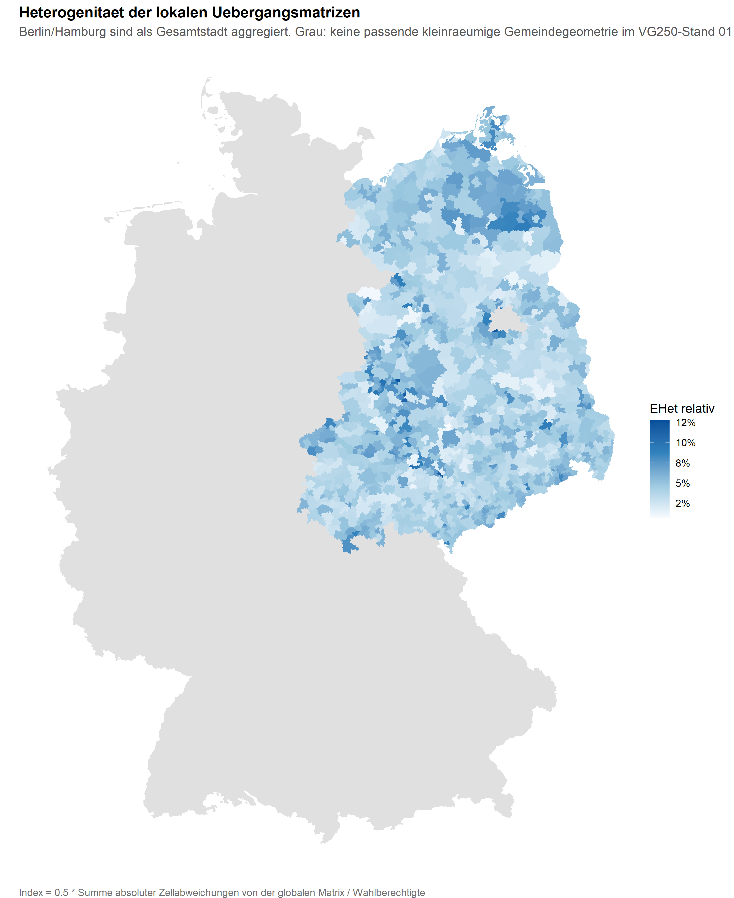
```

## Anhang: EHet Deutschlandschätzung {.custom-smaller}

```{r, echo=FALSE, out.width="90%"}
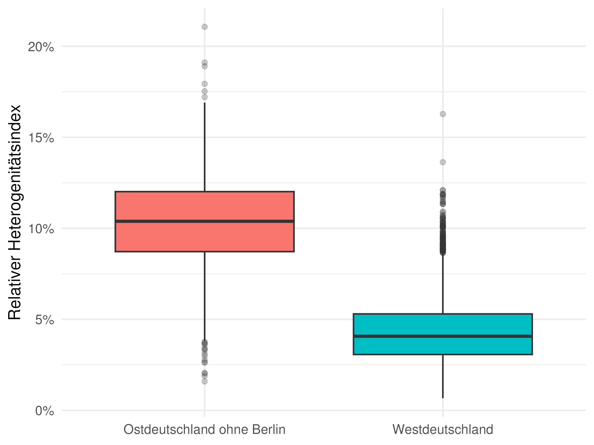
```

## Anhang: EHet Ostdeutschlandschätzung {.custom-smaller}

```{r, echo=FALSE, out.width="90%"}
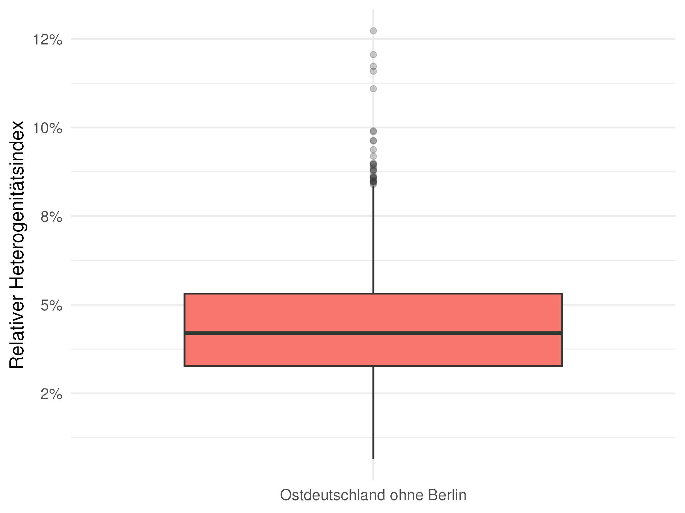
```

## Anhang: Deutschlandweite Übergangsschätzung {.custom-smaller}

```{r, echo=FALSE, out.width="90%"}
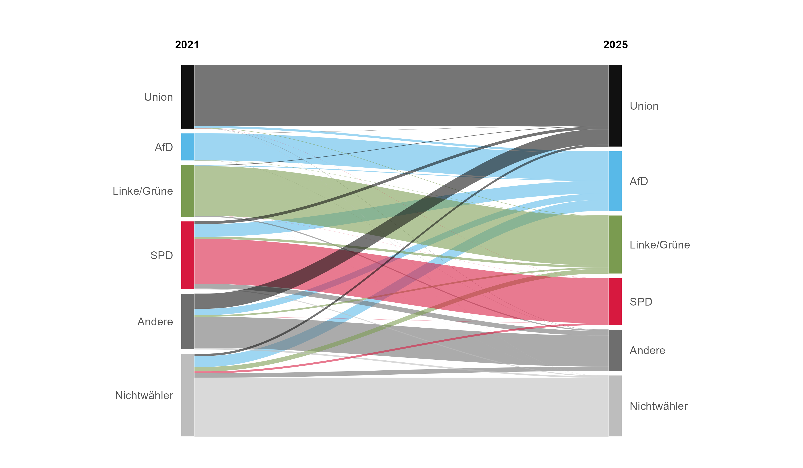
```

## Anhang: Verteilung der Strukturvariablen {.custom-smaller}

```{r, echo=FALSE, out.width="90%"}
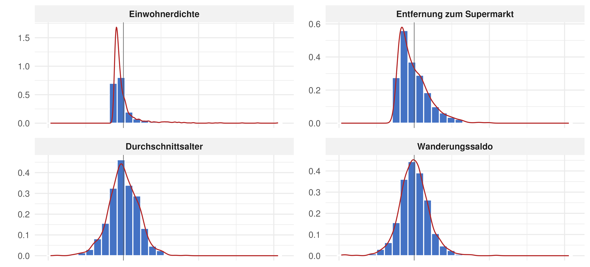
```

## {.custom-smaller}

```{r, echo=FALSE, out.width="90%"}
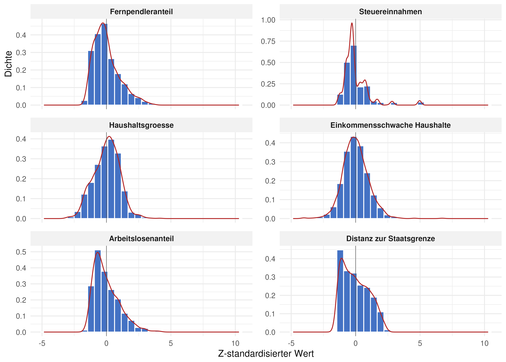
```

## Anhang: Korrelationsmatrix der Strukturvariablen {.custom-smaller}

```{r, echo=FALSE, out.width="100%"}
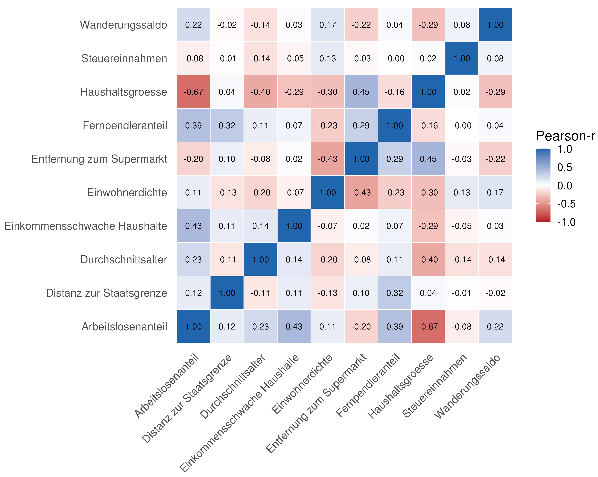
```
---

## Anhang: Merkmalsabweichung der Einheiten mit 25% der größten Übergangsraten {.custom-smaller}

```{r, echo=FALSE, out.width="100%"}
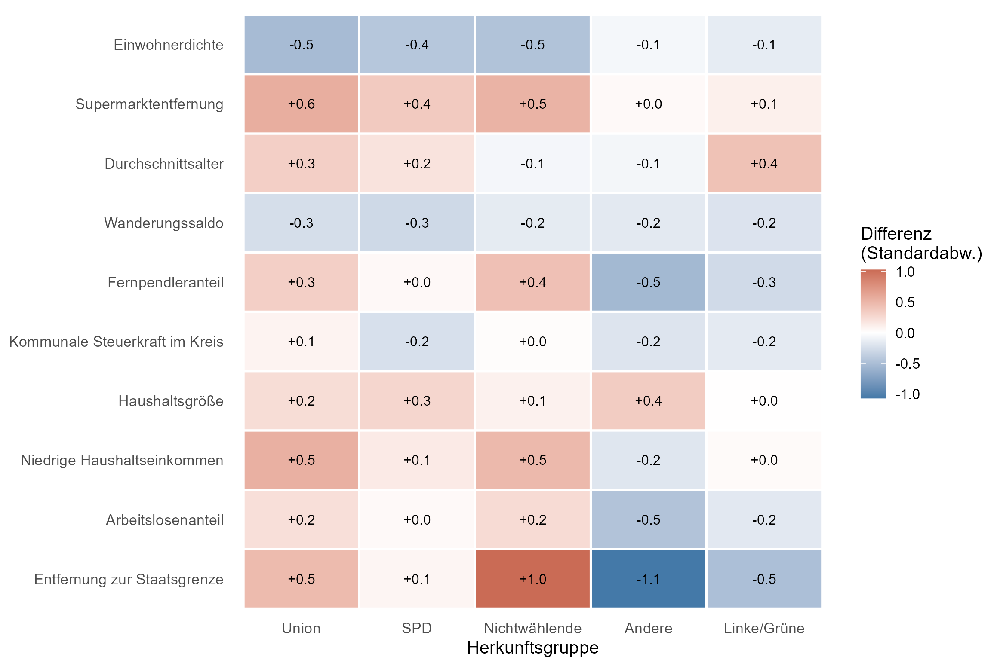
```

## Anhang: vollständige Regressionskoeffizienten {.custom-smaller .top-slide}

::: {style="font-size: 0.85em; line-height: 1.08;"}

| Merkmal | Union | SPD | Nichtwählende | Andere | Linke/Grüne |
|:---|---:|---:|---:|---:|---:|
| Intercept | 33,12 | 23,42 | 16,20 | 11,97 | 2,97 |
| Durchschnittsalter | +1,05 | +0,97 | +0,32 | -0,20 | +0,65 |
| Niedrige Haushaltseinkommen | +1,39 | +1,90 | +0,42 | +0,18 | -0,13 |
| Arbeitslosenanteil | +0,28 | +0,36 | +1,15 | -0,22 | -0,06 |
| Entfernung zur Staatsgrenze | +0,41 | -0,27 | +2,48 | -3,58 | -0,70 |
| Einwohnerdichte | -0,44 | -0,81 | -1,29 | -0,51 | +0,22 |
| Haushaltsgröße | +0,55 | +0,85 | +0,74 | +0,70 | -0,30 |
| Fernpendleranteil | -0,09 | +0,18 | -0,60 | -0,46 | -0,56 |
| Kommunale Steuerkraft im Kreis | +0,26 | -0,49 | +0,27 | -0,16 | -0,27 |
| Supermarktentfernung | +1,16 | +0,95 | +1,57 | -0,21 | +0,81 |
| Wanderungssaldo | -0,48 | -0,26 | +0,13 | -0,11 | +0,02 |

:::


---

## Anhang: Übergangsraten und Modellanpassung {.custom-smaller .top-slide}

::: {style="font-size: 1em; line-height: 1.4;"}

| Herkunft | Median | IQR | Gew. Mittel | $R^2$ |
|:---|---:|---:|---:|---:|
| Union | 33,5 % | 30,9–36,1 % | 31,6 % | 0,513 |
| SPD | 23,0 % | 19,9–26,7 % | 21,1 % | 0,494 |
| Nichtwählende | 14,7 % | 11,3–19,9 % | 14,1 % | 0,634 |
| Andere | 12,0 % | 7,6–15,8 % | 11,0 % | 0,507 |
| Linke/Grüne | 1,0 % | 0,4–4,8 % | 2,3 % | 0,178 |

:::

## Anhang: Regressionsdiagnostik – Q-Q-Plots {.custom-smaller .top-slide}

```{r, echo=FALSE, out.width="100%"}
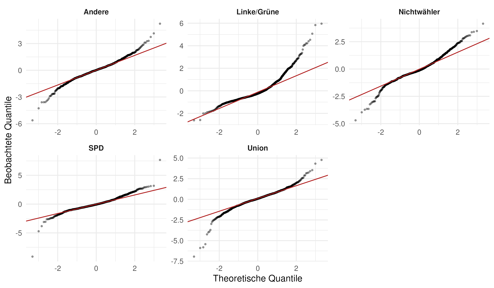
```

## Anhang: Bootstrapverteilungen {.custom-smaller .top-slide}

```{r, echo=FALSE, out.width="100%"}
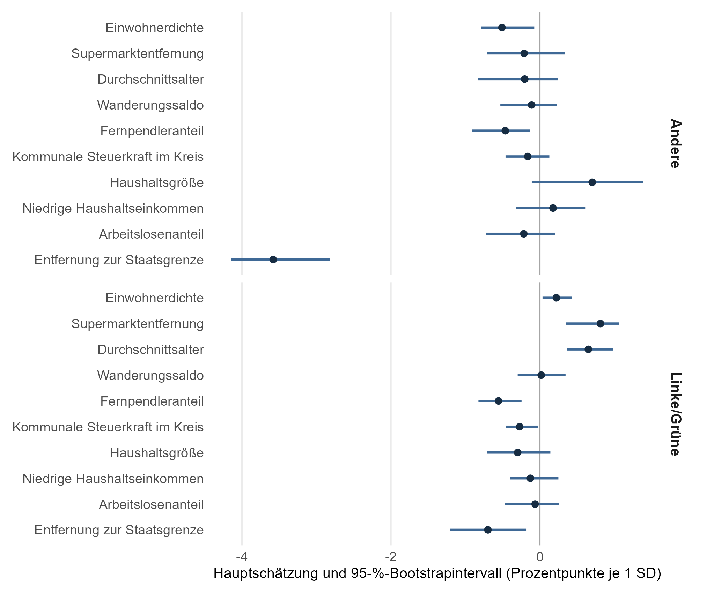
```

## {.custom-smaller .top-slide}

```{r, echo=FALSE, out.width="100%"}
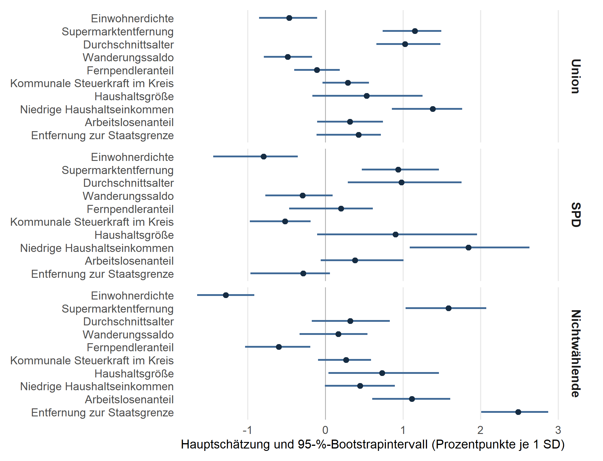
```

## Anhang: Solververgleich OSQP vs. lp_solve {.custom-smaller .top-slide}

Überprüfung der eigenen OSQP-Implementierung

::::: columns
::: {.column width="68%"}

```{r, echo=FALSE, out.width="80%"}
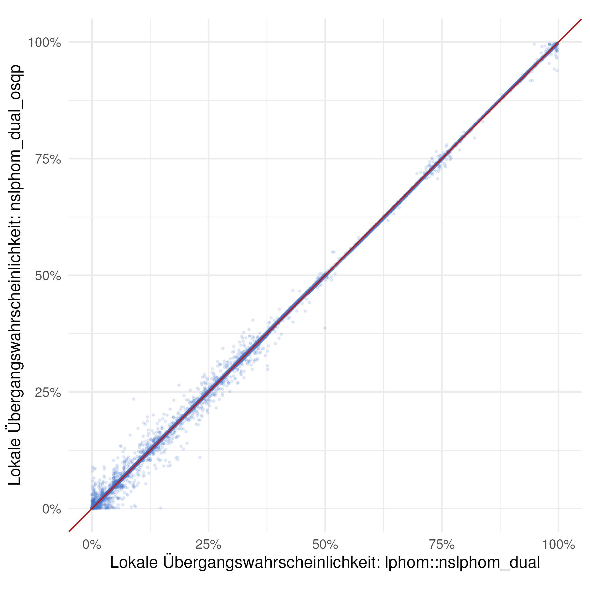
```

:::

::: {.column width="32%"}

<br>

**Übereinstimmung**

- Korrelation: **$r = 0{,}99984$**
- mittlere absolute Abweichung: **0,00137**
- entspricht ca. **0,14 Prozentpunkten**

:::
:::::

## Anhang: Speicherbedarf und Laufzeit der Solver {.custom-smaller .top-slide}

OSQP liefert nahezu identische Ergebnisse bei deutlich geringerem Speicherbedarf

::::: columns
::: {.column width="62%"}

```{r, echo=FALSE, out.width="100%"}
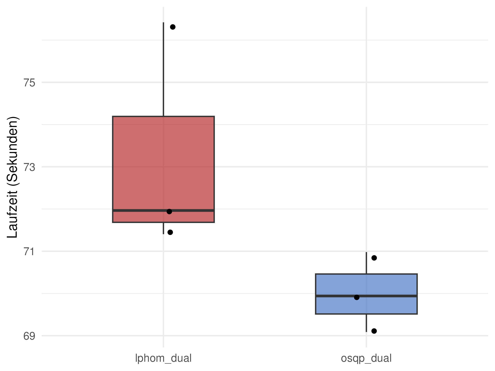
```

:::

::: {.column width="38%"}

### Speicherbedarf

**lp_solve:** ca. 4,90 GB  
**OSQP:** ca. 1,07 GB

$\Rightarrow$ **ca. 78 % weniger Speicher**

:::
:::::

## Anhang: Regressionsdiagnostik – Leverage {.custom-smaller .top-slide}

::::: columns
::: {.column width="70%"}

```{r, echo=FALSE, out.width="100%"}
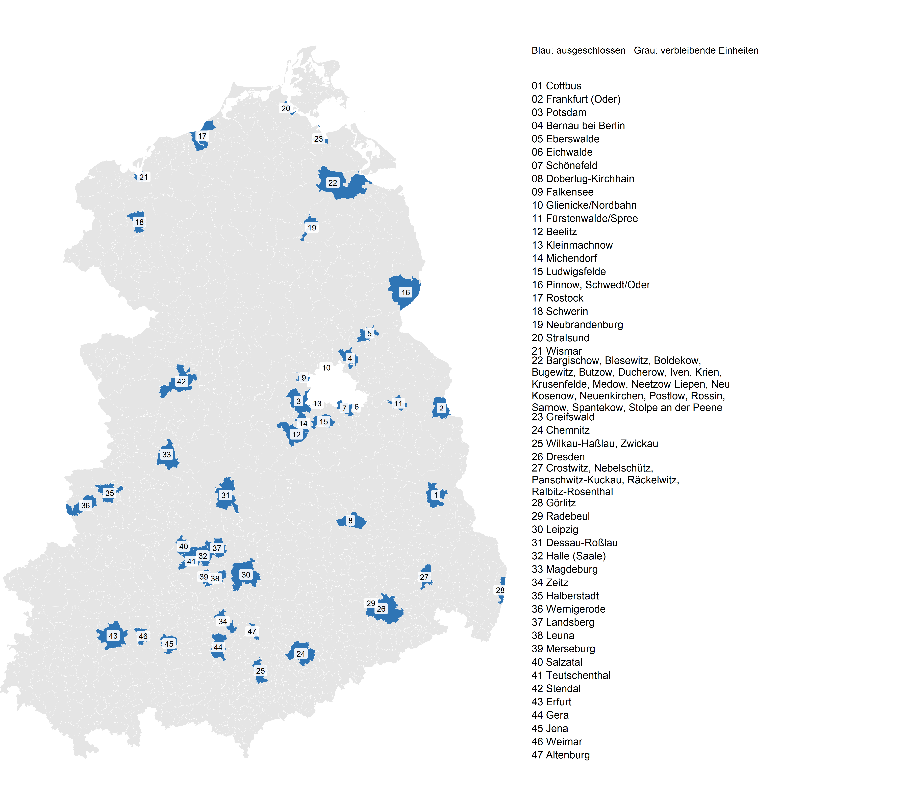
```

:::

::: {.column width="30%"}

<br>

Je Herkunftsmodell: **oberste 3 % der Leverage-Werte**

<br>

In mindestens einem Modell auffällig: **47 Aggregationseinheiten**

<br>

darunter Leipzig, Dresden, Potsdam, Magdeburg, Halle (Saale), etc.

:::
:::::

## Anhang: Regressionsdiagnostik – Cook-Distanz {.custom-smaller .top-slide}

::::: columns
::: {.column width="70%"}

```{r, echo=FALSE, out.width="100%", fig.align="center"}
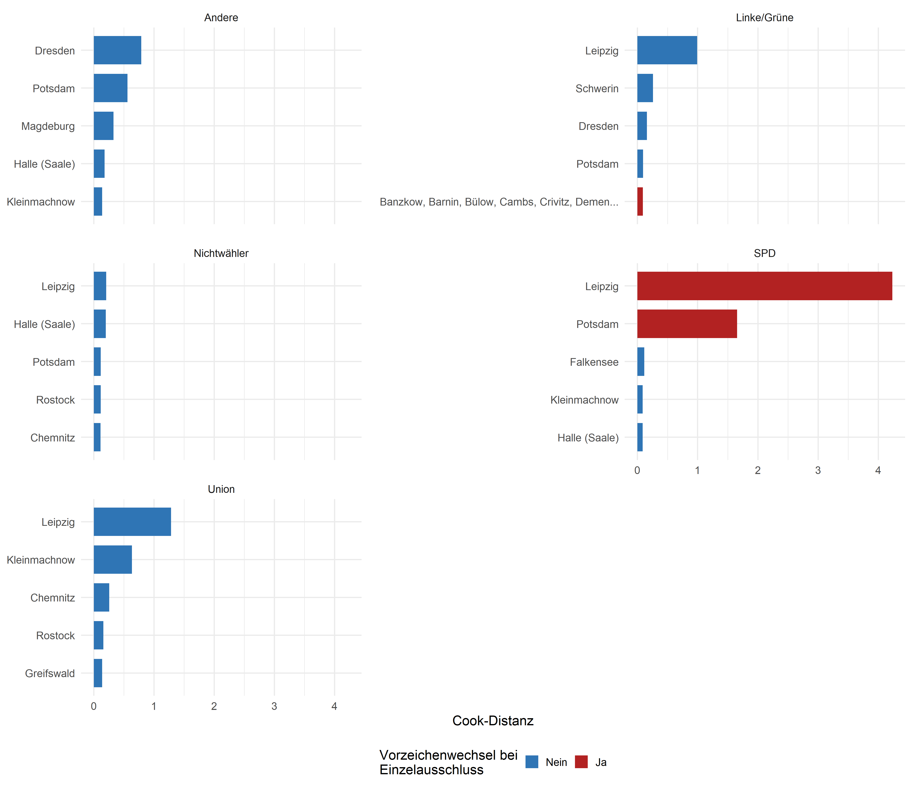
```
:::

::: {.column width="22%"}
<div style="font-size: 0.72em; line-height: 1.3; margin-top: 4.5em;">
Einfluss einzelner Aggregationseinheiten auf die Regressionsschätzung
</div>
:::
:::::
  
## Anhang: Sensitivität zu Leverage-Points {.custom-smaller .top-slide}

::::: columns
::: {.column width="70%"}

<div style="margin-top: -1em;">

```{r, echo=FALSE, out.width="105%", fig.align="center"}
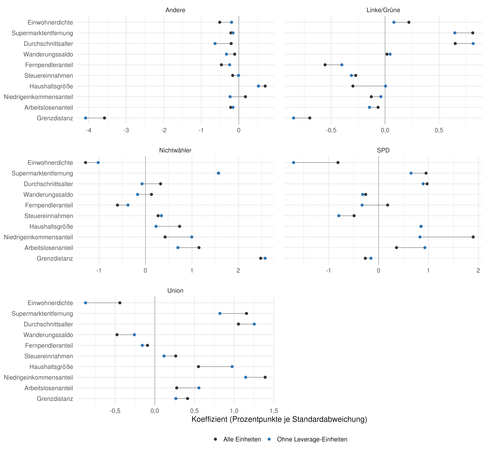
```

</div>
:::

::: {.column width="22%"}

**Sensitivitätsanalyse**

Je Herkunftsmodell erneute Schätzung ohne die obersten 3 % der Leverage-Werte.
:::
:::::

::: {.research-details .fragment}
Alle vorzeichenwechselnden Koeffizienten enthalten 0 im 95-%-Bootstrapintervall.
:::

## Anhang: Simulationsbasierter Recovery-Test {.custom-smaller .prep-uniform}

**Kann die zweistufige Schätzkette bekannte strukturelle Zusammenhänge rekonstruieren?**

::: {.prep-flow}

::: {.prep-box}
**1. Bekannte Wahrheit**

120 räumliche Einheiten

3 Wahloptionen:  
Union · SPD · AfD

2 Kovariaten

bekannte lokale  
Übergangswahrscheinlichkeiten

$\downarrow$

multinomiale Realisierung der Übergangszellen
:::

::: {.prep-arrow}
→
:::

::: {.prep-box}
**2. Ökologische Inferenz**

simulierte 
Wahlränder

`nslphom_dual_osqp`

`iter_max = 10`
:::

::: {.prep-arrow}
→
:::

::: {.prep-box .prep-result}
**3. Regression**

Regression einmal auf

**wahren realisierten Übergängen**

und einmal auf

**nslphom-Schätzungen**
:::

:::

## Anhang: Recovery-Test – Ergebniswerte {.custom-smaller .top-slide}

::: {.data-cards}

::: {.data-card}
**Fehler der lokalen EI**

<span class="data-number">9,13 %</span>

$EI_{loc}$

Anteil der Übergangsmasse,  
der über die lokalen Zellen  
falsch zugeordnet wird
:::

::: {.data-card}
**Regression auf wahren Übergängen**

<span class="data-number">0,01</span>

Prozentpunkte

mittlere absolute Abweichung  
der sechs vorgegebenen  
Regressionskoeffizienten
:::

::: {.data-card}
**Regression nach nslphom**

<span class="data-number">2,13</span>

Prozentpunkte

mittlere absolute Abweichung  
der sechs vorgegebenen  
Regressionskoeffizienten
:::

:::

<br>

**$\Rightarrow$ Die Regressionsstufe selbst rekonstruiert die Zusammenhänge nahezu exakt.**

**$\Rightarrow$ Größere Abweichungen entstehen durch die vorgeschaltete ökologische Inferenz.**


## Anhang: Recovery-Test – Koeffizienten {.custom-smaller .top-slide}

**Vorgegebene Koeffizienten vs. Schätzungen** (149 Simulationen)

```{r, echo=FALSE, out.width="100%", fig.align="center"}
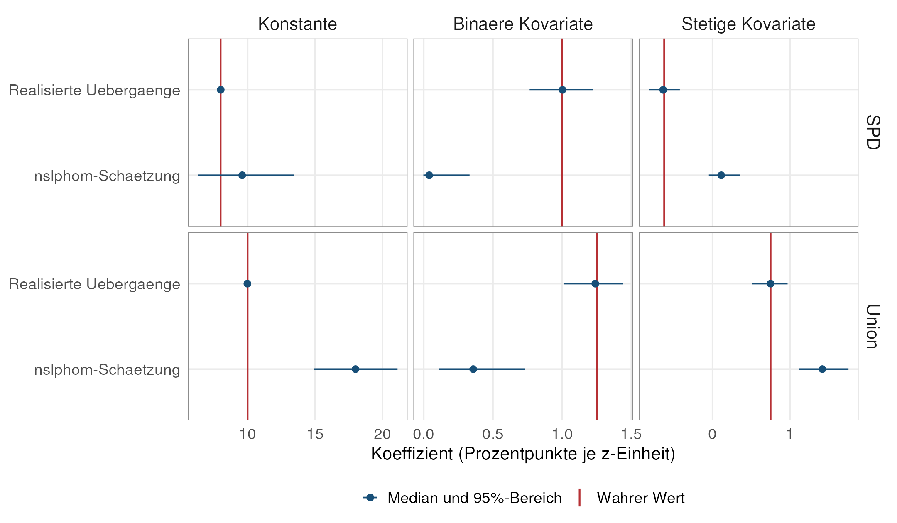
```